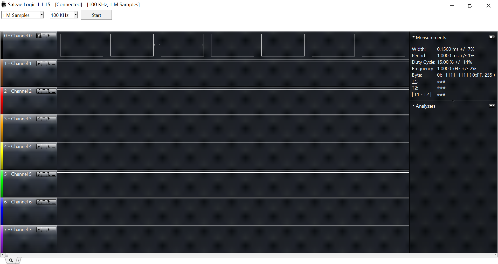

# 6-3 PWM 驱动 LED 呼吸灯

## 功能
TIM2_CH1 输出 PWM 方波接 LED，主循环里循环改 CCR（比较值）改变占空比，LED 平均亮度由暗到亮、再由亮到暗，做出“呼吸”效果。

## 接线
- PA0（TIM2_CH1）→ LED（经限流电阻），LED 另一端 → GND
- OLED（显示用）：SCL → PB8，SDA → PB9
- 电源 → 3.3V，共地 GND

## 用到的代码
- `Hardware/PWM.c/.h`：`PWM_Init`、`PWM_Setcompare1`
  - 开 TIM2（APB1）和 GPIOA（APB2）时钟
  - PA0 配**复用推挽输出 AF_PP**（PWM 走片上定时器通道，不能配成普通推挽）
  - 时基：`TIM_Period = 100 - 1`（ARR=99）、`TIM_Prescaler = 720 - 1`（PSC=719），向上计数
    - 计数时钟 72MHz / 720 = 100kHz；PWM 周期 100 个计数 = 1ms，频率 **1kHz**
  - 输出比较：`TIM_OCMode_PWM1`、`TIM_OCPolarity_High`、`TIM_OutputState_Enable`，初始 `TIM_Pulse = 0`（CCR），`TIM_OC1Init`，`TIM_Cmd` 启动
  - `PWM_Setcompare1(Compare)` → `TIM_SetCompare1(TIM2, Compare)`，运行时改 CCR
- `User/main.c`：`OLED_Init`、`PWM_Init`；while 里两个 for，i 从 0→100 渐亮、100→0 渐暗，每步 `Delay_ms(20)`

### 参数对照（实测）
| 项目 | 值 | 由谁决定 |
|---|---|---|
| 频率 1kHz / 周期 1ms | ARR=99、PSC=719 | 呼吸过程中不变 |
| 占空比 = CCR / (ARR+1) | 0~100% | 只由 CCR 决定 |

## 逻辑分析仪实测波形

呼吸渐变过程中抓了三张不同占空比的截图，覆盖了呼吸过程的不同阶段（对应不同 CCR），可互相印证。

| 截图 | 对应 CCR | Duty Cycle | Period | Width | Width 量到的是哪一侧 | 误差 |
|---|---|---|---|---|---|---|
| 占空比 15% | 15 | 15.00% | 1.000ms | 0.1500ms | 高电平（15% < 50%，高电平更窄） | ±14% |
| 占空比 45% | 45 | 45.00% | 1.000ms | 0.4500ms | 高电平（45% < 50%） | ±3% |
| 占空比 87% | 87 | 87.00% | 1.000ms | 0.1300ms | 低电平（87% > 50%，低电平更窄） | ±8% |

### 一、占空比 87%（对应 CCR=87）

读数：`Frequency 1.000kHz`、`Period 1.000ms`、`Width 0.1300ms`、`Duty Cycle 87%`

### 二、占空比 45%（对应 CCR=45）

读数：`Frequency 1.000kHz`、`Period 1.000ms`、`Width 0.4500ms`、`Duty Cycle 45%`

### 三、占空比 15%（对应 CCR=15）

读数：`Frequency 1.000kHz`、`Period 1.000ms`、`Width 0.1500ms`、`Duty Cycle 15%`

### 四、三次抓取能推出什么

| 结论 | 依据 |
|---|---|
| 频率三次都是 1kHz | 呼吸只改 CCR，时基（PSC/ARR）没动 |
| 占空比 15% / 45% / 87% 分别对应 CCR=15 / 45 / 87 | 占空比 = CCR/(ARR+1) 成立 |
| **`Width` 报的是“最窄脉宽”，不是固定的高/低电平宽度** | 15% 和 45% 时最窄的是高电平 → Width 分别为 0.15ms、0.45ms；87% 时最窄的是低电平 → Width=0.13ms。三次结论不一致，说明它跟极性无关，只取本次抓取里最短的那个脉冲 |
| 想判断高低电平宽度，只能看 `Duty Cycle` | `Duty Cycle` 始终是高电平占比，不受脉宽宽窄影响 |

> 这条结论是三次抓取对照之后才确认的。只用 CCR=50（高低都是 0.5ms）和单张 87% 的图时，很容易误判成“Width 固定量低电平”；45% 那张一出来，那个说法就站不住了，15% 这张进一步坐实。

误差方面：`±3%`（45%）、`±8%`（87%）、`±14%`（15%）都是采样率造成的，且**脉宽越窄误差越大**。100kHz 采样 = 每 10µs 一个点：45% 那张高电平 0.45ms 有 45 个采样点，15% 那张只有 15 个点，量化误差自然被放大。想测窄脉冲就把采样率提到 1MHz（每周期 1000 点），代价是单屏能录的时间变成 1 秒。

另：右侧 `Byte: 0b 1111 1111` 是残留的协议解析器输出，单路 PWM 用不上，忽略即可。

## 遇到的问题

### 1. LED 不亮、PA0 无波形：主通道输出使能字段写错
- 最初把输出比较结构体的**主通道字段**误写成了**互补 N 通道字段**：
  - `TIM_OCNPolarity` 应为 `TIM_OCPolarity`
  - `TIM_OutputNState` 应为 `TIM_OutputState`
- TIM2 是普通定时器，**没有互补通道**。主通道的 `TIM_OutputState` 没被赋值，保持 `TIM_OCStructInit` 填的默认值 DISABLE，CH1 输出被关闭，PA0 上没有波形，LED 自然不亮。
- 改回 `TIM_OCPolarity = TIM_OCPolarity_High`、`TIM_OutputState = TIM_OutputState_Enable` 后，主通道使能，波形正常。

### 2. 逻辑分析仪验证波形（实测结果）
- 接线：分析仪 GND → 开发板 GND（必须共地，否则波形乱跳），CH0 → PA0，其余通道空接；通道是输入，别接 5V 或电源脚。
- 软件：采样率降到 100kHz（1kHz 信号在 24MHz 下采样时间太短、波形挤成一团），1M Samples，CH0 上升沿触发。
- 实测读数：Frequency 1.0000kHz、Period 1.0000ms、Width 0.5000ms、占空比 50%（CCR=50 时），和上面的计算一致，说明定时器、通道、引脚、输出使能都正常。
- Measurements 面板含义：`Period`=完整周期；`Duty Cycle`=高电平占一个周期的比例；`Frequency`=1/Period；`Width`=本次抓取里**最窄脉冲**的宽度（不区分高/低电平，占空比低于 50% 时落在高电平上、高于 50% 时落在低电平上，两次截图对照可验证）；`Byte`=8 位电平打包（单路 PWM 用不上）；T1/T2=手动游标（### 表示没放游标）。

### 3. 分析仪看不到呼吸渐变
- 逻辑分析仪是**抓快照再回放**，不是示波器那种实时滚动；呼吸占空比是秒级慢速变化，单屏短采样只能拍到某一个固定占空比的几段方波，看不出宽窄变化。
- 想看脉宽渐变趋势：把采样率降到 5~10kHz 拉长录制，抓完横向缩小全览；动态效果直接肉眼看 LED 最直接。

### 4. 其他
- 局部变量名 `TIM_OCInitSteucture` 拼写有误（应为 Structure），只是命名不规范，**不影响编译和功能**。
- 若亮度方向和预期相反（占空比越大越暗），说明 LED 是低电平点亮，可对调两个 for 的方向，或把极性改成 `TIM_OCPolarity_Low`。