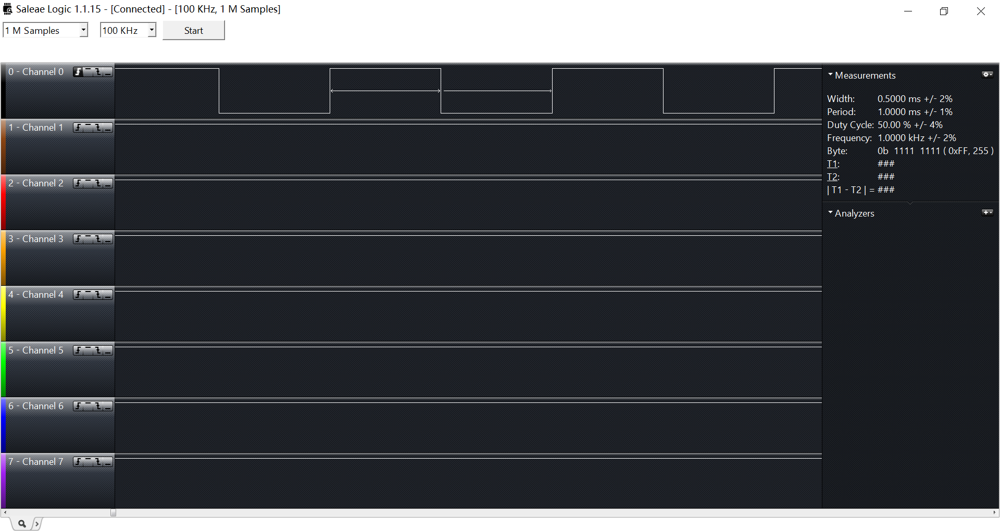

# 6-3 PWM 驱动 LED 呼吸灯

## 功能
TIM2_CH1 输出 PWM 方波接 LED，主循环里循环改 CCR（比较值）改变占空比，LED 平均亮度由暗到亮、再由亮到暗，做出“呼吸”效果。

## 接线
- PA0（TIM2_CH1）→ LED（经限流电阻），LED 另一端 → GND
- OLED（显示用）：SCL → PB8，SDA → PB9
- 电源 → 3.3V，共地 GND

## 用到的代码
- `Hardware/PWM.c/.h`：`PWM_Init`、`PWM_Setcompare1`
  - 开 TIM2（APB1）和 GPIOA（APB2）时钟
  - PA0 配**复用推挽输出 AF_PP**（PWM 走片上定时器通道，不能配成普通推挽）
  - 时基：`TIM_Period = 100 - 1`（ARR=99）、`TIM_Prescaler = 720 - 1`（PSC=719），向上计数
    - 计数时钟 72MHz / 720 = 100kHz；PWM 周期 100 个计数 = 1ms，频率 **1kHz**
  - 输出比较：`TIM_OCMode_PWM1`、`TIM_OCPolarity_High`、`TIM_OutputState_Enable`，初始 `TIM_Pulse = 0`（CCR），`TIM_OC1Init`，`TIM_Cmd` 启动
  - `PWM_Setcompare1(Compare)` → `TIM_SetCompare1(TIM2, Compare)`，运行时改 CCR
- `User/main.c`：`OLED_Init`、`PWM_Init`；while 里两个 for，i 从 0→100 渐亮、100→0 渐暗，每步 `Delay_ms(20)`

### 参数对照（实测）
| 项目 | 值 | 由谁决定 |
|---|---|---|
| 频率 1kHz / 周期 1ms | ARR=99、PSC=719 | 呼吸过程中不变 |
| 占空比 = CCR / (ARR+1) | 0~100% | 只由 CCR 决定 |

## 逻辑分析仪实测波形

呼吸渐变过程中抓了五张不同占空比的快照，每张各负责证明一件事，不是随手拍的读数堆砌。

> **一句话结论**：`Period`、`Frequency`、`Duty Cycle` 与光标位置无关，可信；`Width` 只量“光标指着的那一段脉冲”，挪一下位置读数就变。**判断占空比只信 `Duty Cycle`，别读 `Width`。**

抓取条件五张完全一致：采样率 100kHz、1M Samples、CH0 上升沿触发、CH0 接 PA0、分析仪 GND 与开发板共地。

| 图 | 对应 CCR | Duty Cycle（容差） | Width（容差） | Width 落在 | 这张图用来证明什么 |
|---|---|---|---|---|---|
| 占空比 1% | 1 | 1.00% ±200% | 10 µs ±100% | 高电平，只落 1 个采样点 | 采样率不够时读数直接失真 |
| 占空比 15% | 15 | 15.00% ±14% | 0.1500ms ±7% | 高电平 | 窄脉冲的误差量级 |
| 占空比 50% | 50 | 50.00% ±4% | 0.5000ms ±2% | 高、低都是 0.5ms，分不出 | 对称点测不出极性——最早误判的来源 |
| 占空比 86% | 86 | 86.00% ±3% | 0.8600ms ±2% | **高电平（这时高电平才是“宽”的那侧）** | 证伪“Width = 最窄脉宽” |
| 占空比 92% | 92 | 92.00% ±3% | 80 µs ±13% | 低电平 | 与 86% 同为高占空比却翻面 → 光标决定 |

### 一、占空比 50%（CCR=50）：最容易被误读的基准点

读数：`Frequency 1.000kHz`、`Period 1.0000ms`、`Width 0.5000ms`、`Duty Cycle 50.00%`

这张是“波形正常”的第一道验收：CCR=50 时高电平 0.5ms、低电平也是 0.5ms，和 ARR=99 的推算完全一致，说明定时器、通道、引脚、输出使能都配对了。

但它**不能用来判断 `Width` 量的是哪一侧**——两边都是 0.5ms，光标停在哪都读 0.5000ms。最早那版 README 就是拿着这一张，顺手把 `Width` 理解成“低电平宽度”的，坑从这里埋下。所以这张留在文档里的意义是“反例”：它示范了什么样的点没有判读价值。

### 二、占空比 86%（CCR=86）：决定性的一张

读数：`Frequency 1.000kHz`、`Period 1.000ms`、`Width 0.8600ms`、`Duty Cycle 86.00%`

占空比 86% = 高电平 0.86ms + 低电平 0.14ms，**窄的是低电平**。可这张 `Width` 报的偏偏是 0.8600ms，也就是**宽**的那一侧。“Width 报最窄脉宽”这个说法在这里直接被判死。

### 三、占空比 92%（CCR=92）：同一区间，方向翻面

读数：`Frequency 1.000kHz`、`Period 1.000ms`、`Width 80 µs`、`Duty Cycle 92.00%`

86% 和 92% 都在高占空比区，条件没变，但 `Width` 从 0.86ms（高电平）变成了 80µs（低电平）。唯一被改变的是**光标停在哪段脉冲上**——变量就此锁定。

### 四、占空比 15%（CCR=15）：窄脉冲的误差量级

读数：`Frequency 1.000kHz`、`Period 1.000ms`、`Width 0.1500ms`、`Duty Cycle 15.00%`

高电平 150µs，在 100kHz 采样下是 15 个点，容差 ±7%。这个精度还能当数值用，但已经提醒你：**脉宽越窄，越不能信容差后面那位小数**。

### 五、占空比 1%（CCR=1）：量化下限

读数：`Frequency 1.000kHz`、`Period 1.000ms`、`Width 10 µs`、`Duty Cycle 1.00%`

100kHz 采样一个点就是 10µs，而 1% 的高电平恰好 10µs——**整段高电平只落到了 1 个采样点**。于是 `Width` 容差 ±100%、`Duty Cycle` 容差 ±200%。这已经不是“测不准”，而是“分辨率不够”：这一档只能定性说“接近熄灭”，读数不能当数值用。

### 六、判读规则速查

| 想知道 | 看哪个字段 | 原因 |
|---|---|---|
| 频率对不对 | `Frequency` / `Period` | 全局统计，与光标无关 |
| 占空比对不对 | `Duty Cycle` | 始终是高电平占比，与光标无关 |
| 高电平多宽 | `Duty Cycle × Period` | 不要读 `Width` |
| 低电平多宽 | `(1 − Duty Cycle) × Period` | 同上 |
| 这次指着那段多宽 | `Width` | 只反映光标所在脉冲，换个位置就换值 |

### 七、`Width` 判读的三次修正（留档，避免重走）

| 版本 | 当时手里的图 | 结论 | 为什么看着自洽 / 后来怎么被推翻 |
|---|---|---|---|
| 第一版 | CCR=50、占空比 87% | `Width` = 低电平宽度 | 50% 时高低都是 0.5ms，本就分不出；87% 那张光标恰在低电平上，读数 0.13ms，看着对上了 |
| 第二版 | 再加 45%、15% | `Width` = 最窄脉宽 | 45% 和 15% 两张光标都在高电平，而那侧恰好更窄，仍然自洽 |
| 第三版（现行） | 再加 86%、92%、1% | `Width` = 光标所在那段脉冲的宽度 | 86% 高电平是宽侧，`Width` 却是 0.86ms；92% 同区间又翻回低电平。**变量是光标位置，不是极性，也不是脉宽** |

教训：只用“某一测都成立”的样本归纳规律，等于没验证。要么刻意去找会打脸的样本（86%、92% 这类），要么就别把话说成规律。

### 八、误差全部来自 100kHz 量化

| 高电平宽度 | 采样点数（10µs/点） | 面板容差 |
|---|---|---|
| 860µs | 86 | ±2% |
| 500µs | 50 | ±2% |
| 150µs | 15 | ±7% |
| 80µs（低电平） | 8 | ±13% |
| 10µs | 1 | ±100%（`Duty Cycle` 甚至 ±200%） |

要测窄脉冲就把采样率提到 1MHz（每周期 1000 点，10µs 变 100 个点），代价是 1M Samples 下只能录 1 秒。

另：右侧 `Byte` 是残留的协议解析器输出（`0b 1111 1111` 或 `0b 1111 1110`，取决于抓取结束点落在周期里的哪个位置），单路 PWM 用不上，忽略即可。

## 遇到的问题

### 1. LED 不亮、PA0 无波形：主通道输出使能字段写错
- 最初把输出比较结构体的**主通道字段**误写成了**互补 N 通道字段**：
  - `TIM_OCNPolarity` 应为 `TIM_OCPolarity`
  - `TIM_OutputNState` 应为 `TIM_OutputState`
- TIM2 是普通定时器，**没有互补通道**。主通道的 `TIM_OutputState` 没被赋值，保持 `TIM_OCStructInit` 填的默认值 DISABLE，CH1 输出被关闭，PA0 上没有波形，LED 自然不亮。
- 改回 `TIM_OCPolarity = TIM_OCPolarity_High`、`TIM_OutputState = TIM_OutputState_Enable` 后，主通道使能，波形正常。

### 2. 逻辑分析仪验证波形（实测结果）
- 接线：分析仪 GND → 开发板 GND（必须共地，否则波形乱跳），CH0 → PA0，其余通道空接；通道是输入，别接 5V 或电源脚。
- 软件：采样率降到 100kHz（1kHz 信号在 24MHz 下采样时间太短、波形挤成一团），1M Samples，CH0 上升沿触发。
- 实测读数：Frequency 1.0000kHz、Period 1.0000ms、Width 0.5000ms、占空比 50.00%（CCR=50 时），和上面的计算一致，说明定时器、通道、引脚、输出使能都正常（波形见上一节“占空比 50%”那张）。
- Measurements 面板含义：`Period`=完整周期；`Duty Cycle`=高电平占一个周期的比例（与光标位置无关，判断占空比只信这个）；`Frequency`=1/Period；`Width`=**测量光标所在那段脉冲**的宽度，换光标位置读数就跟着变，既不代表固定极性也不代表最窄脉宽（详见上文五张对照图）；`Byte`=8 位电平打包（单路 PWM 用不上）；T1/T2=手动游标（### 表示没放游标）。

### 3. 分析仪看不到呼吸渐变
- 逻辑分析仪是**抓快照再回放**，不是示波器那种实时滚动；呼吸占空比是秒级慢速变化，单屏短采样只能拍到某一个固定占空比的几段方波，看不出宽窄变化。
- 想看脉宽渐变趋势：把采样率降到 5~10kHz 拉长录制，抓完横向缩小全览；动态效果直接肉眼看 LED 最直接。
- 折中办法就是本文的做法：**在呼吸过程中连续抓几张不同占空比的快照，拼成一张表**，同样能说明“占空比在 1%~92% 之间连续变化”。
- 想稳定抓某个指定 CCR 的点：在 `PWM_Setcompare1` 调用处下 Keil 断点，程序停下时定时器仍在跑、输出不停（别在 Debug 设置里勾 DBGMCU 的 TIM2 freeze），此时抓到的波形占空比固定在断点那一刻，可以精确复现任意 CCR。
- 另：如果拿 RC 低通（10kΩ+10µF，fc≈1.6Hz）把 PWM 滤成模拟电压再看，那属于**直流电平**，逻辑分析仪只有数字输入、按阈值判高低，看不到呼吸曲线，必须用万用表或示波器。

### 4. 其他
- 局部变量名 `TIM_OCInitSteucture` 拼写有误（应为 Structure），只是命名不规范，**不影响编译和功能**。
- 若亮度方向和预期相反（占空比越大越暗），说明 LED 是低电平点亮，可对调两个 for 的方向，或把极性改成 `TIM_OCPolarity_Low`。