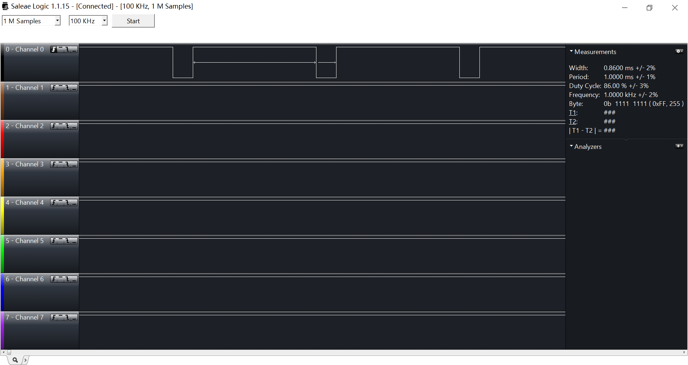

# 6-3 PWM 驱动 LED 呼吸灯

## 功能
TIM2_CH1 输出 PWM 方波接 LED，主循环里循环改 CCR（比较值）改变占空比，LED 平均亮度由暗到亮、再由亮到暗，做出“呼吸”效果。

## 接线
- PA0（TIM2_CH1）→ LED（经限流电阻），LED 另一端 → GND
- OLED（显示用）：SCL → PB8，SDA → PB9
- 电源 → 3.3V，共地 GND

## 用到的代码
- `Hardware/PWM.c/.h`：`PWM_Init`、`PWM_Setcompare1`
  - 开 TIM2（APB1）和 GPIOA（APB2）时钟
  - PA0 配**复用推挽输出 AF_PP**（PWM 走片上定时器通道，不能配成普通推挽）
  - 时基：`TIM_Period = 100 - 1`（ARR=99）、`TIM_Prescaler = 720 - 1`（PSC=719），向上计数
    - 计数时钟 72MHz / 720 = 100kHz；PWM 周期 100 个计数 = 1ms，频率 **1kHz**
  - 输出比较：`TIM_OCMode_PWM1`、`TIM_OCPolarity_High`、`TIM_OutputState_Enable`，初始 `TIM_Pulse = 0`（CCR），`TIM_OC1Init`，`TIM_Cmd` 启动
  - `PWM_Setcompare1(Compare)` → `TIM_SetCompare1(TIM2, Compare)`，运行时改 CCR
- `User/main.c`：`OLED_Init`、`PWM_Init`；while 里两个 for，i 从 0→100 渐亮、100→0 渐暗，每步 `Delay_ms(20)`

### 参数对照（实测）
| 项目 | 值 | 由谁决定 |
|---|---|---|
| 频率 1kHz / 周期 1ms | ARR=99、PSC=719 | 呼吸过程中不变 |
| 占空比 = CCR / (ARR+1) | 0~100% | 只由 CCR 决定 |

## 逻辑分析仪实测波形

呼吸渐变过程中抓了五张不同占空比的截图，覆盖从接近熄灭到接近全亮的不同阶段（对应不同 CCR），可互相印证。

| 截图 | 对应 CCR | Duty Cycle | Period | Width | Width 落在哪段脉冲上 | Width 读数本身就是 |
|---|---|---|---|---|---|---|
| 占空比 1% | 1 | 1.00% ±200% | 1.000ms | 10 µs ±100% | 高电平（只有 1 个采样点） | 高电平宽度 = 10µs |
| 占空比 15% | 15 | 15.00% ±14% | 1.000ms | 0.1500ms ±7% | 高电平 | 高电平宽度 = 150µs |
| 占空比 37% | 37 | 37.00% ±6% | 1.000ms | 0.3700ms ±3% | 高电平 | 高电平宽度 = 370µs |
| 占空比 86% | 86 | 86.00% ±3% | 1.000ms | 0.8600ms ±2% | **高电平（此时高电平是“宽”的那一侧，低电平只有 0.14ms）** | 高电平宽度 = 860µs |
| 占空比 92% | 92 | 92.00% ±3% | 1.000ms | 80 µs ±13% | 低电平 | 低电平宽度 = 80µs |

### 一、占空比 1%（对应 CCR=1）——量化下限

读数：`Frequency 1.000kHz`、`Period 1.000ms`、`Width 10 µs`、`Duty Cycle 1.00%`

这张是全组里最有价值的边界样本：100kHz 采样下一个点就是 10µs，而 1% 的高电平恰好只有 10µs，**等于只落到了 1 个采样点**。所以 `Width` 的容差是 ±100%、`Duty Cycle` 的容差是 ±200%——误差已经不是“测不准”，而是“分辨率不够”。这一档读数只能定性说“接近关闭”，不能当数值用。

### 二、占空比 15%（对应 CCR=15）

读数：`Frequency 1.000kHz`、`Period 1.000ms`、`Width 0.1500ms`、`Duty Cycle 15.00%`

### 三、占空比 37%（对应 CCR=37）

读数：`Frequency 1.000kHz`、`Period 1.000ms`、`Width 0.3700ms`、`Duty Cycle 37.00%`

### 四、占空比 86%（对应 CCR=86）——决定性的一张

读数：`Frequency 1.000kHz`、`Period 1.000ms`、`Width 0.8600ms`、`Duty Cycle 86.00%`

占空比 86% 意味着高电平 0.86ms、低电平只有 0.14ms，**窄的是低电平**。可这张的 `Width` 报的是 0.8600ms，也就是宽的那一侧。这一条直接把“Width 报最窄脉宽”判死。

### 五、占空比 92%（对应 CCR=92）

读数：`Frequency 1.000kHz`、`Period 1.000ms`、`Width 80 µs`、`Duty Cycle 92.00%`

同一侧（都是高占空比），86% 量到高电平、92% 量到低电平，`Width` 的方向换了——换的是光标停在哪段脉冲上。

### 六、五次抓取能推出什么

| 结论 | 依据 |
|---|---|
| 频率五次都是 1kHz | 呼吸只改 CCR，时基（PSC/ARR）没动 |
| 占空比 1 / 15 / 37 / 86 / 92% 分别对应 CCR=1 / 15 / 37 / 86 / 92 | 占空比 = CCR/(ARR+1) 成立 |
| **`Width` 量的是“测量光标所在那段脉冲”的宽度，既不是固定极性、也不是最窄脉宽** | 86% 时窄的是低电平，`Width` 却是 0.86ms（高电平）；92% 时又变成 80µs（低电平）。同样在高占空比，结果随光标位置变化 |
| 想算高电平宽度，别读 `Width`，用 `Duty Cycle × Period` | `Duty Cycle` 始终是高电平占比，与光标无关 |
| 脉宽越窄，误差越大 | 容差从 ±2%（860µs）→ ±7%（150µs）→ ±100%（10µs）单调恶化 |

> **关于 `Width` 的判读，这里前后修正过两次，记下来避免以后再走弯路：**
> 1. 第一版（只有 CCR=50 和 87% 两张图）：写成“`Width` = 低电平宽度”。CCR=50 时高低各 0.5ms 本来分不清，87% 那张光标恰好在低电平上，就误以为规律成立。
> 2. 第二版（加进 45%、15%）：改成“`Width` = 最窄脉宽”。这两张光标都在高电平（当时恰好更窄的那侧），看着也自洽。
> 3. 现在（86% 那张进来）：`Width` = 0.86ms 但窄的是低电平，第二种说法同样不成立。**真正起作用的变量是光标位置，不是极性也不是脉宽。**
>
> 换句话说，`Width` 是个“就地量你指着的那段”的游标读数，`Duty Cycle` 才是与位置无关的全局统计。看占空比永远信 `Duty Cycle`。

误差方面：全部来自 100kHz 采样（每 10µs 一个点）的量化。0.86ms 有 86 个点、容差 ±2%；0.37ms 有 37 个点、±3%；0.15ms 有 15 个点、±7%；10µs 只剩 1 个点、±100%。想测窄脉冲就把采样率提到 1MHz（每周期 1000 点），代价是 1M 采样点下只能录 1 秒。

另：右侧 `Byte`（1% / 15% / 37% / 86% 四张为 `0b 1111 1111`，92% 那张为 `0b 1111 1110`，取决于抓取结束点落在一周期的哪个位置）是残留的协议解析器输出，单路 PWM 用不上，忽略即可。

## 遇到的问题

### 1. LED 不亮、PA0 无波形：主通道输出使能字段写错
- 最初把输出比较结构体的**主通道字段**误写成了**互补 N 通道字段**：
  - `TIM_OCNPolarity` 应为 `TIM_OCPolarity`
  - `TIM_OutputNState` 应为 `TIM_OutputState`
- TIM2 是普通定时器，**没有互补通道**。主通道的 `TIM_OutputState` 没被赋值，保持 `TIM_OCStructInit` 填的默认值 DISABLE，CH1 输出被关闭，PA0 上没有波形，LED 自然不亮。
- 改回 `TIM_OCPolarity = TIM_OCPolarity_High`、`TIM_OutputState = TIM_OutputState_Enable` 后，主通道使能，波形正常。

### 2. 逻辑分析仪验证波形（实测结果）
- 接线：分析仪 GND → 开发板 GND（必须共地，否则波形乱跳），CH0 → PA0，其余通道空接；通道是输入，别接 5V 或电源脚。
- 软件：采样率降到 100kHz（1kHz 信号在 24MHz 下采样时间太短、波形挤成一团），1M Samples，CH0 上升沿触发。
- 实测读数：Frequency 1.0000kHz、Period 1.0000ms、Width 0.5000ms、占空比 50%（CCR=50 时），和上面的计算一致，说明定时器、通道、引脚、输出使能都正常。
- Measurements 面板含义：`Period`=完整周期；`Duty Cycle`=高电平占一个周期的比例（与光标位置无关，判断占空比只信这个）；`Frequency`=1/Period；`Width`=**测量光标所在那段脉冲**的宽度，换光标位置读数就跟着变，既不代表固定极性也不代表最窄脉宽（详见上文“逻辑分析仪实测波形”一节的五张对照图）；`Byte`=8 位电平打包（单路 PWM 用不上）；T1/T2=手动游标（### 表示没放游标）。

### 3. 分析仪看不到呼吸渐变
- 逻辑分析仪是**抓快照再回放**，不是示波器那种实时滚动；呼吸占空比是秒级慢速变化，单屏短采样只能拍到某一个固定占空比的几段方波，看不出宽窄变化。
- 想看脉宽渐变趋势：把采样率降到 5~10kHz 拉长录制，抓完横向缩小全览；动态效果直接肉眼看 LED 最直接。
- 折中办法就是本文的做法：**在呼吸过程中连续抓几张不同占空比的快照，拼成一张表**，同样能说明“占空比在 1%~92% 之间连续变化”。
- 想稳定抓某个指定 CCR 的点：在 `PWM_Setcompare1` 调用处下 Keil 断点，程序停下时定时器仍在跑、输出不停（别在 Debug 设置里勾 DBGMCU 的 TIM2 freeze），此时抓到的波形占空比固定在断点那一刻，可以精确复现任意 CCR。
- 另：如果拿 RC 低通（10kΩ+10µF，fc≈1.6Hz）把 PWM 滤成模拟电压再看，那属于**直流电平**，逻辑分析仪只有数字输入、按阈值判高低，看不到呼吸曲线，必须用万用表或示波器。

### 4. 其他
- 局部变量名 `TIM_OCInitSteucture` 拼写有误（应为 Structure），只是命名不规范，**不影响编译和功能**。
- 若亮度方向和预期相反（占空比越大越暗），说明 LED 是低电平点亮，可对调两个 for 的方向，或把极性改成 `TIM_OCPolarity_Low`。