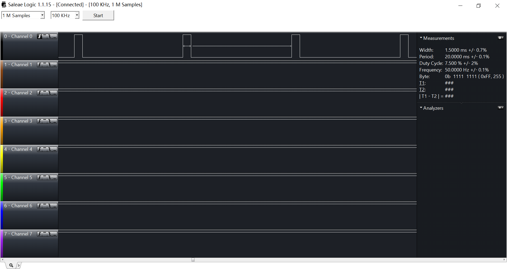

# 6-4 PWM 驱动舵机

## 功能
TIM2_CH2 输出 50Hz 舵机控制信号，按角度换算成对应脉宽；按 Key1 每次角度 +30°（超过 180° 回 0），OLED 显示当前角度。

## 接线
- PA1（TIM2_CH2）→ 舵机信号线（橙/黄线）
- 舵机 VCC → 外部 5V（舵机电流大，不要从 STM32 3.3V 引脚取动力电）
- 舵机 GND → 与 STM32 **共地**
- 按键：Key1 → PB1，Key2 → PB11（上拉输入，低电平有效）
- OLED：SCL → PB8，SDA → PB9

## 用到的代码
- `Hardware/PWM.c/.h`：`PWM_Init`、`PWM_Setcompare2`
  - 开 TIM2、GPIOA 时钟；PA1 配 AF_PP
  - 时基：`TIM_Period = 20000 - 1`（ARR=19999）、`TIM_Prescaler = 72 - 1`（PSC=71）
    - 计数时钟 72MHz / 72 = 1MHz（1 个计数 = 1μs）；周期 20000μs = 20ms = **50Hz**，舵机标准频率
  - `TIM_OCMode_PWM1`、High、Enable，`TIM_OC2Init`，`TIM_Cmd` 启动
  - `PWM_Setcompare2` → `TIM_SetCompare2(TIM2, Compare)`
- `Hardware/Servo.c/.h`：`Servo_Init`（调 PWM_Init）、`Servo_SetAngle(float Angle)`
  - 角度换算：`CCR = Angle / 180 * 2000 + 500`
  - 0° → 500μs，180° → 2500μs（1MHz 计数下 CCR 数值即微秒数）
- `Hardware/Key.c/.h`：`Key_Init`、`Key_GetNum`，PB1/PB11 上拉输入，20ms 软件消抖
- `User/main.c`：初始化 OLED/舵机/按键，初始 90°；Key1 按下 Angle+=30，>180 回 0；`Servo_SetAngle(Angle)`，OLED 显示角度

## 逻辑分析仪实测波形

三个角度各抓一张，把"角度 → CCR → 实际脉宽"这条链从公式推算变成实测。

抓取条件：采样率 100kHz、1M Samples、CH0 接 PA1、分析仪 GND 与开发板共地、CH0 上升沿触发。20ms 周期在 100kHz 下是 2000 个采样点，1M Samples 一屏能录 10 秒、约 5 个周期，脉宽和周期可以同屏读清。

| 图 | 角度 | 代码算出的 CCR | 理论脉宽 | 实测 Width | 实测 Duty Cycle | 实测 Period / Frequency |
|---|---|---|---|---|---|---|
| 脉宽 500µs | 0° | 500 | 0.5ms | 0.5000ms ±2% | 2.500% ±4% | 20.0000ms ±0.1% / 50.000Hz |
| 脉宽 1500µs | 90° | 1500 | 1.5ms | 1.5000ms ±0.7% | 7.500% ±2% | 20.0000ms ±0.1% / 50.000Hz |
| 脉宽 2500µs | 180° | 2500 | 2.5ms | 2.5000ms ±0.4% | 12.500% ±0.8% | 20.0000ms ±0.1% / 50.000Hz |

### 一、0°（CCR=500）

读数：`Frequency 50.000Hz`、`Period 20.0000ms`、`Width 0.5000ms`、`Duty Cycle 2.500%`

### 二、90°（CCR=1500）

读数：`Frequency 50.000Hz`、`Period 20.0000ms`、`Width 1.5000ms`、`Duty Cycle 7.500%`

### 三、180°（CCR=2500）

读数：`Frequency 50.000Hz`、`Period 20.0000ms`、`Width 2.5000ms`、`Duty Cycle 12.500%`

### 四、三张合起来验证了什么

| 结论 | 依据 |
|---|---|
| 频率确实是 50Hz、周期 20ms | 三张 `Period` 都是 20.0000ms，容差仅 ±0.1%，说明 PSC=71 / ARR=19999 的 1MHz 计数完全正确 |
| **CCR 数值就是脉宽的微秒数** | CCR=500 / 1500 / 2500 分别实测到 0.5ms / 1.5ms / 2.5ms，一一对上 |
| `Servo_SetAngle` 的线性换算成立 | 三个角度对应的脉宽刚好等差 1000µs，说明 `CCR = Angle/180×2000+500` 这条公式没写错，而且是从 0° 到 180° 全程线性 |
| 占空比 = 脉宽 / 20ms | 2.5% / 7.5% / 12.5%，与面板 `Duty Cycle` 读数完全一致 |

误差方面：100kHz 采样 = 每 10µs 一个点。500µs 有 50 个点（±2%）、1500µs 有 150 个点（±0.7%）、2500µs 有 250 个点（±0.4%），**脉宽越宽精度越高**，这条规律与 6-3 一致。周期 20ms 有 2000 个点，所以 `Period` 容差只有 ±0.1%，比 6-3 的 ±1% 好一个数量级——慢信号天生好测。

关于 `Width` 落在哪段脉冲：这三张都量到高电平，因为占空比最大才 12.5%，光标停在高电平那段；它的判读规则（`Width` 跟光标走、与极性无关）在 6-3 的 README 里用五张图验证过，这里不再重复。

## 遇到的问题 / 注意事项

### 1. 舵机频率不能照搬呼吸灯参数
- 舵机要求 **50Hz（20ms 周期）**，ARR/PSC 必须按 20ms 配；直接套用 6-3 的 1kHz 参数，舵机不会正常转。
- 脉宽范围 0.5\~2.5ms 对应 0\~180°，CCR 超出这个范围舵机可能抖动、堵转或乱动；具体脉宽范围以所用舵机 datasheet 为准，必要时校准公式。

### 2. 供电和共地
- 舵机转动电流比 GPIO 大，动力电要单独供（外部 5V/驱动板），不要指望 STM32 3.3V 引脚带；信号线是 3.3V 电平，舵机一般能识别。
- 舵机 GND 必须和 STM32 共地，否则信号参考电平不稳，舵机乱抖。

### 3. 其他
- 局部变量名 `Steucture` 拼写不规范。**已于 2026-11-22 统一改名为 `TIM_OCInitStructure`**（与 6-3 一并修正），纯改名、逻辑不变。
- 本工程已用逻辑分析仪抓了 0°/90°/180° 三张波形，读数与代码推算一一吻合，见上文“逻辑分析仪实测波形”一节。