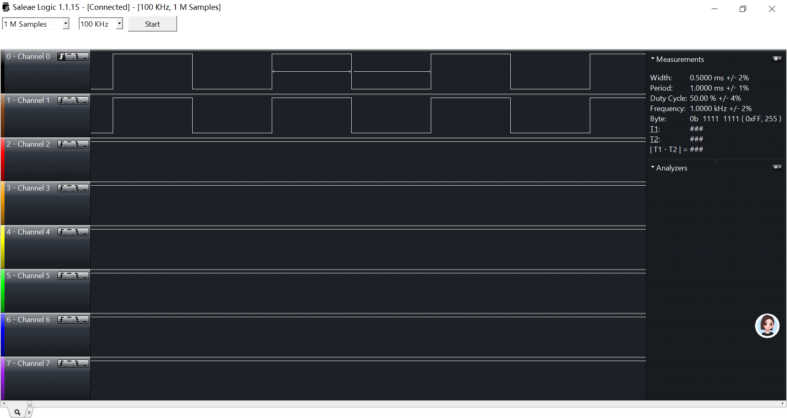
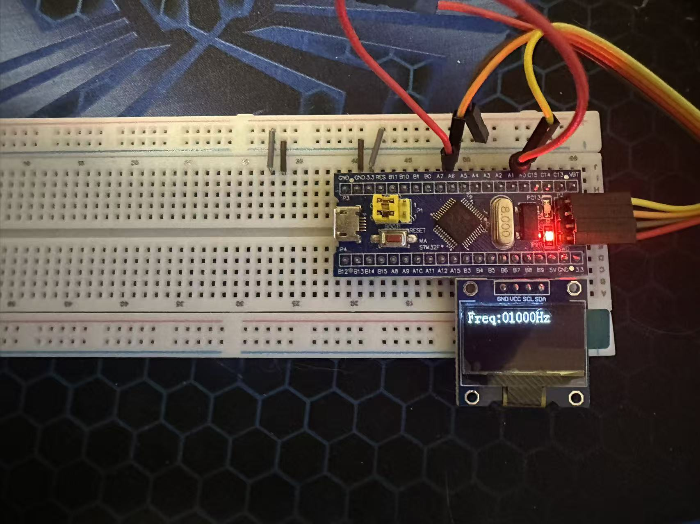

# 6-6 输入捕获模式测频率

## 功能
用 TIM3_CH1（PA6）捕获外部方波的周期，换算出频率，显示在 OLED 第一行 `Freq:xxxxxHz`。

被测信号不是从外面接进来的，而是本工程的 TIM2_CH1（PA0）自己发出来的：PA0 与 PA6 之间用一根杜邦线短接，形成"自己发、自己测"的自测回环。

## 接线

| 连接 | 说明 |
|---|---|
| PA0（TIM2_CH1，PWM 输出）→ PA6（TIM3_CH1，捕获输入） | **一根杜邦线短接，这一步不能漏**，不接就测不到任何东西 |
| OLED：SCL → PB8，SDA → PB9 | 显示读数 |
| 3.3V、GND | 供电，全板共地 |

想测外部信号时，把那根跳线拔掉，把信号源输出接到 PA6：要求 3.3V 电平、与开发板共地、频率在 15Hz 到 500kHz 之间（量程由来见下文）。

## 为什么用自测回环

验证"测频率"准不准，前提是手上有**频率已知**的信号，普通玩家没有信号发生器。开发板上正好有定时器能发 PWM，一根跳线把输出接回输入，信号源就有了，还能随时改频率来验证捕获值跟不跟着变。

## 用到的代码

### `Hardware/IC.c`
- `IC_Init`
  - 开 TIM3（APB1）和 GPIOA（APB2）时钟
  - PA6 配**上拉输入 IPU**：捕获脚是输入，不能配成输出；上拉是为了信号没接时读到稳定高电平，不悬空乱触发
  - 时基：`TIM_Period = 65536 - 1`（ARR 取满）、`TIM_Prescaler = 72 - 1`（PSC=71）
    - 计数时钟 72MHz / 72 = **1MHz**，一个计数就是 1µs，读出来天生是微秒数
    - ARR 取满是为了低频信号也不中途溢出
  - 输入捕获：CH1、上升沿、**直连 TI1**、不分频、`TIM_ICFilter = 0xF`（滤波最高档，f_DTS/32 采样、连续 8 次电平一致才认）
  - 触发与从模式：`TIM_SelectInputTrigger(TIM3, TIM_TS_TI1FP1)` + `TIM_SelectSlaveMode(TIM3, TIM_SlaveMode_Reset)`
  - 最后 `TIM_Cmd` 启动
- `IC_GetFreq()`：`1000000 / (CCR1 + 1)`

### 关键原理：从模式复位让 CCR1 直接等于一个周期

普通输入捕获只能量出"两个边沿之间的计数值"，还得自己算差、自己存上一次的值。这里打开**从模式复位（SlaveMode_Reset）**，把清零这件事交给硬件：

| 时刻 | 硬件做了什么 |
|---|---|
| 上升沿到来 | ① CNT 被清零 ② CCR1 锁存此刻的计数值 |
| 下一个上升沿 | 再清零、再锁存，CCR1 更新为"一整个周期数了多少个 1µs" |
| 读频率 | 1MHz ÷ 周期计数 = 频率，不需要任何减法 |

`+1` 的来历：复位与捕获发生在同一时刻，捕获到的值比真实周期少 1 个计数，补上 1 才是完整周期。不加 1 的话，1kHz 这类整数频率会读成 1001Hz 一类偏大的值（约偏 0.1%）。

### `Hardware/PWM.c`
- 与 6-3 相同的老三样：TIM2_CH1、PA0 配 AF_PP、`TIM_OCMode_PWM1` + 高极性 + 输出使能、`TIM_Cmd` 启动
- 比 6-3 多了 `PWM_SetPrescaler(PSC)` → `TIM_PrescalerConfig(TIM2, PSC, TIM_PSCReloadMode_Immediate)`
  - **立即重载是关键**：默认的 Update 模式要等计数器溢出一次才装载新 PSC，改完频率后 OLED 会有一小段还显示旧值；Immediate 当场生效
  - 有了它，`main` 里一行就能改输出频率，正好演示"输入信号频率变了，捕获值跟着变"
- 文件开头三行被注释掉的代码是**备选方案**：把 CH1 重映射到 PA15。PA15 默认是 JTAG 的 JTDI 脚，得连 `GPIO_Remap_SWJ_JTAGDisable` 一起开才能当普通 IO，代价是失去 JTAG 调试，所以最终仍用默认的 PA0

### `User/main.c`
- 顺序：`OLED_Init` → `PWM_Init` → `IC_Init`
- 先 `OLED_ShowString(1, 1, "Freq:00000Hz")` 把固定文字画出来，数字几位留给 `OLED_ShowNum` 反复刷新（`ShowNum` 只覆盖数字区，左边的 `Freq:` 不会被擦掉）
- `PWM_SetPrescaler(720 - 1)`：72MHz ÷ 720 ÷ 100 = **1kHz**
- `PWM_Setcompare1(50)`：占空比 50%
- while 里只有一句 `OLED_ShowNum(1, 6, IC_GetFreq(), 5)`

## 参数对照（设计值与实测）

| 项目 | 值 | 由谁决定 |
|---|---|---|
| 被测信号频率 | 1kHz | PWM 侧 PSC=719、ARR=99 |
| 被测信号占空比 | 50% | PWM 侧 CCR=50 |
| 捕获计数时钟 | 1MHz（1 计数 = 1µs） | IC 侧 PSC=71 |
| 一个周期的计数 | 1000 | 1MHz ÷ 1kHz |
| 实测显示 | `01000Hz`（屏摄见下文实测小节） | `1000000 / (1000)` |

## 量程与精度

| 项目 | 边界 | 原因 |
|---|---|---|
| 最低可测频率 | 约 15.3Hz | ARR=65535 最多数 65536 个 1µs，再低就溢出，读数会绕回 |
| 最高可测频率 | 约 500kHz | 一个周期至少要有 2 个计数才分得清两个上升沿 |
| 频率分辨率 | ±1Hz 量级 | 计数值有 ±1 个计数的量化误差，低频时相对误差更明显 |
| 显示上限 | 99999Hz | `OLED_ShowNum` 只留了 5 位，超过 10 万就显示不全 |
| 占空比 | 本工程不测 | 单通道只算周期；要测占空比看 6-7 |

想提高精度：把 IC 的 PSC 改小（如 `PSC = 0` → 72MHz 计数，1 计数约 13.9ns），但量程下限会升到约 1.1kHz，而且 `IC_GetFreq` 里的 `1000000` 必须同步改成 `72000000`。

## 逻辑分析仪实测波形

抓图条件：采样率 100kHz、1M Samples、CH0 上升沿触发；CH0 接 PA0（发出的信号）、CH1 接 PA6（捕获输入），分析仪 GND 与开发板共地。

测量面板读数：`Period 1.0000ms ±1%`、`Frequency 1.0000kHz ±2%`、`Duty Cycle 50.00% ±4%`、`Width 0.5000ms ±2%`、`Byte 0xFF`。

一张图证明两件事：

| 证据 | 从图上怎么看 | 结论 |
|---|---|---|
| 链路是通的 | CH0 与 CH1 的边沿落在同一条竖线上，各自高、低段宽度一致（各约半个周期） | PA0 到 PA6 的跳线真的接上了，信号确实进了 TIM3_CH1 |
| 信号参数是对的 | 周期 1.0000ms、占空比 50.00% | PWM 侧 PSC=719、ARR=99、CCR=50 都配对了 |

也要说清逻辑分析仪本身**不证明**什么：它量的是引脚上的电平，看不到 TIM3 内部的 CNT/CCR，"捕获算得准不准"必须靠 OLED 读数去对。

板载 OLED 实测（同一套配置下拍下）：第一行显示 `Freq:01000Hz`。

两路证据合起来才是闭环：

| 器测（逻辑分析仪） | 屏显（TIM3 捕获结果） | 结论 |
|---|---|---|
| `Period 1.0000ms` / `Frequency 1.0000kHz` | `Freq:01000Hz` | 捕获值与真实信号一致，没有可观测误差 |

这条顺带验证了 `IC_GetFreq` 里那个 `+1`：1kHz 对应 1000 个 1µs 计数，若按 `1000000 / CCR1`（不加 1）算，CCR1=999 时会读出 1001Hz，屏上就不是 1000 了。现在正好显示 1000，说明这个补偿是对的。

`Width 0.5000ms` 在这里没有判读价值：50% 占空比时高、低都是 0.5ms，光标停在哪边读数都一样——6-3 那五张图就是为了拆穿这一点。容差 `±4%` 来自 100kHz 采样下 0.5ms 只有 50 个点，量级正常。

### 五分钟上手：这个软件其实只有三步

如果只想"抓一张能看的图"，Logic 1.x 的操作可以压到三步：

| 步骤 | 动作 | 要点 |
|---|---|---|
| 1 | 接线：GND 接板子 GND，CH0 接 PA0，CH1 接 PA6 | 漏了共地波形会乱跳；通道是输入，别接到 5V 或电源脚 |
| 2 | 顶部采样深度设 `1M Samples`、采样率设 `100 KHz`，按 `Start` | 1kHz 这种慢信号 100kHz 采样足够；拉到 24MHz 反而录不到几个完整周期 |
| 3 | 抓完点一下要测的那一路波形（选中通道），看右侧 `Measurements` | 只看 `Period`、`Frequency`、`Duty Cycle`；`Width` 不要拿来算占空比 |

右侧 `Analyzers` 那一栏是**协议解码器**（CAN、I2C、SPI 之类），本实验用不上，点开弹出的菜单直接 Esc 关掉；`Measurements` 面板里的 `+` 才是加测量项，两个不是一回事。

## 遇到的问题与常见坑

### 1. 捕获一直是 0Hz：漏了那根跳线
PA0 和 PA6 必须短接。不接的话 PA6 被上拉成一条恒定高电平，没有边沿，CNT 不清零也不更新，`CCR1` 恒为 0，显示 0Hz。

排查顺序：先量 PA0 有没有波形（有逻辑分析仪就双通道看，没有就外接 LED 看亮度）→ 再确认杜邦线插的是 PA6 不是 PB6 → 最后确认 `TIM_Cmd(TIM3, ENABLE)` 执行到了。

### 2. 读数偶尔跳到很离谱的数
- `TIM_ICFilter = 0xF` 已经是最高档滤波，如果还跳，多半是杜邦线太长、接触不良，或信号源与开发板没共地
- 偶发一个异常大数：捕获瞬间正好赶上计数器溢出，属于单次异常，下一轮就恢复

### 3. 改了频率读数要等一会儿才变
`TIM_PrescalerConfig` 的第三个参数要用 `TIM_PSCReloadMode_Immediate`。用 `TIM_PSCReloadMode_Update` 的话，新 PSC 要等计数器溢出一次才装载，现象就是"改完还是旧频率"。

### 4. 其他
- `main.c` 里 `PWM_SetPrescaler(720 - 1)` 与 `PWM_Init` 里的默认 PSC=719 重复，功能上无害（初始化本来就是 1kHz）。保留它是因为这行是"改频率"的显式入口，改这一个数就能改被测信号频率。
- 捕获脚配 `GPIO_Mode_IPU` 而不是浮空输入，是为了信号断开时电平确定（浮空读到的电平随机，容易误触发）。
- `IC_GetFreq` 里的 `1000000` 与 `PSC = 71` 是绑定的（"1 秒有多少个计数"）。改了 IC 的 PSC 却忘记改这个常数，算出来的频率会整体偏一个固定比例，这种错很难从读数上看出异常，最容易踩。
