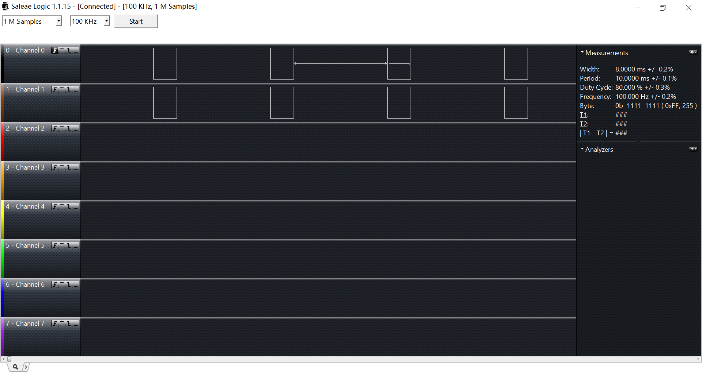
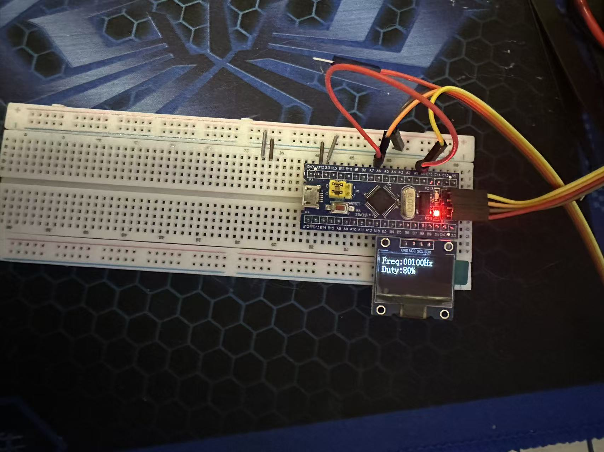
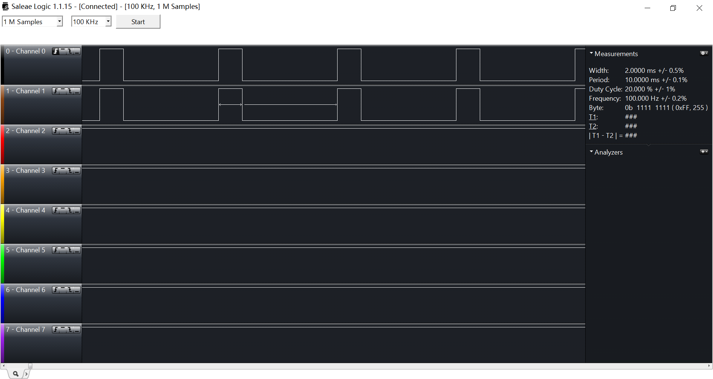
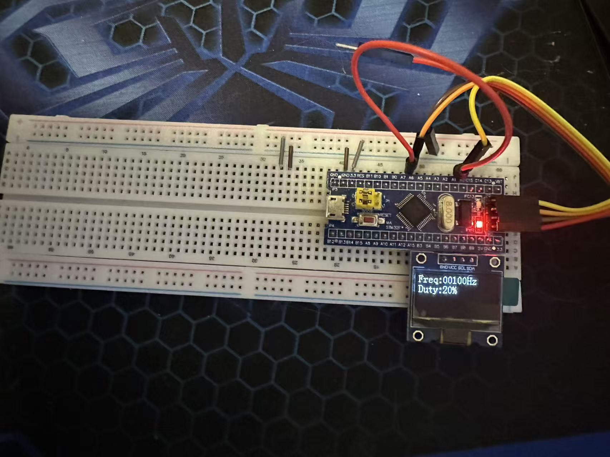

# 6-7 PWMI 模式测频率占空比

## 功能
用 TIM3 的 **PWMI 模式**（PWM Input），一根信号线同时测出方波的频率和占空比，OLED 两行分别显示：

- 第 1 行 `Freq:xxxxxHz`
- 第 2 行 `Duty:xx%`

被测信号由本工程的 TIM2_CH1（PA0）发出，PA0 与 PA6 用一根杜邦线短接，还是"自己发、自己测"的自测回环。

## 接线

| 连接 | 说明 |
|---|---|
| PA0（TIM2_CH1，PWM 输出）→ PA6（TIM3_CH1，PWMI 输入） | **一根杜邦线短接**，CH2 在片内借用同一路 TI1，不需要第二根线 |
| OLED：SCL → PB8，SDA → PB9 | 显示频率与占空比 |
| 3.3V、GND | 供电，全板共地 |

## 与 6-6 的区别：一个通道变两个通道

6-6 只测频率（一个通道数周期），6-7 加了占空比（再加一个通道数高电平时间）。除此之外，引脚、定时器、PSC、ARR、滤波、触发源、从模式全都一样。

| 项目 | 6-6 输入捕获 | 6-7 PWMI |
|---|---|---|
| 配置函数 | `TIM_ICInit`（只配 CH1） | `TIM_PWMIConfig`（配 CH1 + 自动配 CH2） |
| CH1 | 上升沿、直连 TI1 | 上升沿、直连 TI1 → 捕获整个周期 CCR1 |
| CH2 | 未使用 | 下降沿、间接映射 TI1 → 捕获高电平时间 CCR2 |
| 对外引脚 | PA6 | PA6（一根线） |
| 读出的量 | 频率 | 频率 + 占空比 |

### `TIM_PWMIConfig` 到底替你做了什么

库函数 `stm32f10x_tim.c` 里这段逻辑说得很清楚：它按结构体里写的那一个通道（CH1 或 CH2）先配一遍，然后把**同一对里的另一半**自动配成"相反的一套"——极性取反、选择取反（DirectTI 变 IndirectTI），滤波和分频沿用同一份参数。

| 你写的结构体 | 库函数补的那一半 | 结果 |
|---|---|---|
| CH1、Rising、DirectTI、Filter=0xF | CH2、Falling、IndirectTI、Filter=0xF | CH1 锁存周期，CH2 锁存高电平时间，两个通道都从 TI1（PA6）取信号 |

所以代码里 CH2 一行都不用写。**反过来说，如果结构体写成 CH2**，库函数会把 CH1 配成下降沿，CCR1 就变成"低电平时间"，频率和占空比的算式全得跟着改——这是很容易踩的坑。

### 为什么两个通道能共用一根线

CH2 用 `TIM_ICSelection_IndirectTI`，意思是"CH2 的输入不接 TI2，而是内部交叉借用 TI1"。同一路 PA6 信号同时送进两个捕获通道，一个在上升沿锁存、一个在下降沿锁存，各自不需要额外的引脚。

## 用到的代码

### `Hardware/IC.c`
- `IC_Init`：与 6-6 完全一致的部分不再重复（TIM3 时钟、PA6 上拉输入、ARR=65535、PSC=71 得 1MHz、`TIM_ICFilter=0xF`、`TIM_TS_TI1FP1` + `TIM_SlaveMode_Reset`）
- 唯一改动：`TIM_ICInit` 换成 `TIM_PWMIConfig`
- `IC_GetFreq()`：`1000000 / (CCR1 + 1)`，同 6-6
- `IC_GetDuty()`：`(CCR2 + 1) * 100 / (CCR1 + 1)`
  - 先乘 100 再除，是为尽量保住精度
  - 但整数除法仍会截断，**80% 的占空比可能显示 79 或 80**，这是 1% 显示分辨率的正常现象，不是测错
  - 想要 0.1% 分辨率：改成 `(CCR2+1)*1000/(CCR1+1)`，再自己插小数点

### `User/main.c`
- `OLED_Init` → `PWM_Init` → `IC_Init`
- 两行固定文字先画：`Freq:00000Hz`、`Duty:00%`，数字位留给 `OLED_ShowNum` 刷新
- `PWM_SetPrescaler(7200 - 1)`：72MHz ÷ 7200 ÷ 100 = **100Hz**
- `PWM_Setcompare1(80)`：占空比 **80%**
- while 里两句：`OLED_ShowNum(1, 6, IC_GetFreq(), 5)`、`OLED_ShowNum(2, 6, IC_GetDuty(), 2)`
- `Hardware/PWM.c` 与 6-6 完全相同，只是 `main` 里把频率从 1kHz 改成 100Hz

## 参数对照（设计值与实测）

| 项目 | 值 | 由谁决定 |
|---|---|---|
| 被测信号频率 | 100Hz | PWM 侧 PSC=7199、ARR=99 |
| 被测信号占空比 | 80% | PWM 侧 CCR=80 |
| 捕获计数时钟 | 1MHz（1 计数 = 1µs） | IC 侧 PSC=71 |
| 整个周期的计数 | 10000 | 1MHz ÷ 100Hz |
| 高电平的计数 | 8000 | 10000 × 80% |
| 实测显示 | `00100Hz`、`80%`（屏摄见下文实测小节，未出现 79） | 上面的算式 |
| 对照工况实测 | 改 `PWM_Setcompare1(20)` 后：`00100Hz`、`20%` | 见下文"20% 对照"一节 |

为什么 demo 用 100Hz 而不是 1kHz：100Hz 时一个周期 10000 个计数、高电平 8000 个计数，两个值都远离 65535 的溢出线，同时占空比的分辨率也更细（1 个计数只占 0.01%）。1kHz 时 CCR1 只有 1000，虽然也能用，但数值小、看分辨率变化不直观。

## 量程与精度

| 项目 | 边界 / 表现 | 原因 |
|---|---|---|
| 最低可测频率 | 约 15.3Hz | ARR=65535 最多数 65536 个 1µs，周期再长就溢出 |
| 最高可测频率 | 约 500kHz | 一个周期至少 2 个计数才分得清两个边沿 |
| 频率分辨率 | ±1Hz 量级 | ±1 个计数的量化误差 |
| 占空比分辨率（代码层） | 1% | `*100` 后整除，只输出整数百分比 |
| 占空比分辨率（硬件层） | 1 个计数 | 100Hz 时是 0.01%，1kHz 时是 0.1%；占空比越接近 0% 或 100% 绝对误差越小 |
| 极端占空比 | 会失真 | 高电平不足 1 个计数时 CCR2 可能是 0 或 1，窄脉冲测不准 |

## 逻辑分析仪实测波形

抓图条件：采样率 100kHz、1M Samples、CH0 上升沿触发；CH0 接 PA0（发出的信号）、CH1 接 PA6（PWMI 输入），分析仪 GND 与开发板共地。

测量面板读数：`Period 10.0000ms ±0.1%`、`Frequency 100.000Hz ±0.2%`、`Duty Cycle 80.000% ±0.3%`、`Width 8.0000ms ±0.2%`、`Byte 0xFF`。

| 证据 | 从图上怎么看 | 结论 |
|---|---|---|
| 链路是通的 | CH0 与 CH1 两条波形的边沿完全对齐 | PA0 到 PA6 的跳线接上了，同一路信号进了 TIM3 的 CH1/CH2 |
| 频率对 | `Period 10.0000ms` → `100.000Hz` | PWM 侧 PSC=7199、ARR=99 配对了 |
| 占空比对 | `Duty Cycle 80.000%`，高电平 8ms、低电平 2ms | CCR=80 配对了；100kHz 采样下 100 点/周期，精度比 6-6 那组好得多 |

### 这张图上最容易读错的一处：`Width` 跟着测量线走，不等于高电平时间

这次的测量线停在高电平那一段，所以 `Width` 读 `8.0000ms`，数值上正好等于 `Duty Cycle × Period` = 80% × 10ms。但这是测量线位置造成的巧合，不是规律：把测量线拖到低电平那段，同一路信号会读成 `2.0000ms`——下面 20% 对照那张的 `Width = 2.0000ms` 也是停在最窄的一段上，含义与这张的 8ms 完全相反。

所以 6-3 那条结论在这里同样成立：`Width` 只报当前测量线跨过那一小段的宽度，与占空比的高低无关；判断占空比只信 `Duty Cycle` 与 `Period`。

### 板载 OLED 实测

两行显示 `Freq:00100Hz`、`Duty:80%`，与器测对得上：

| 量 | 器测 | 屏显 | 结论 |
|---|---|---|---|
| 频率 | `Frequency 100.000Hz` | `00100Hz` | 一致 |
| 占空比 | `Duty Cycle 80.000%`（高 8ms / 周期 10ms） | `80%` | 一致，说明 CCR2 量到的确实是高电平那 8ms（8000 个计数），不是低电平的 2ms |

这也回答了 `IC_GetDuty` 整数除法会不会把 80% 截成 79 的疑问：`(CCR2+1)*100/(CCR1+1)` = `8001 × 100 ÷ 10001` = 80.002，截断后仍是 80。换算到计数可得证：100Hz 一个周期是 10000 个 1µs，80% 即 8000 个，两个数都在 65535 以内，不会溢出。

还能反过来验一遍极性：假如 CCR2 被错配成"低电平 2ms"，算式会给出 `2001×100÷10001` ≈ 20%，屏上就该是 20% 而不是 80%。现在显示 80%，说明 CH2 确实落在下降沿（量的是高电平那一段），`TIM_PWMIConfig` 自动补的那套参数是对的。

### 20% 对照：排除"碰巧算出 80%"

只抓 80% 一张，只能证明"这一次算出了 80"。把 `PWM_Setcompare1(80)` 改成 `20` 再抓一次，面板读数：`Period 10.0000ms ±0.1%`、`Frequency 100.000Hz ±0.2%`、`Duty Cycle 20.00% ±1%`、`Width 2.0000ms ±0.5%`、`Byte 0xFF`。

屏显同步变成 `Freq:00100Hz`、`Duty:20%`：

| 工况 | 器测 | 屏显 | 结论 |
|---|---|---|---|
| CCR=80 | `Duty Cycle 80.000%`（高 8ms、低 2ms） | `80%` | 对得上 |
| CCR=20 | `Duty Cycle 20.00%`（高 2ms、低 8ms） | `20%` | 对得上 |

两张一起放，才算把"算对了"和"碰巧对了"区分开：80% 那张若 CCR2 取错了段（取到低电平），会算出 20%；20% 这张若同样取错，会算出 80%。两个方向都被否掉，说明 `TIM_PWMIConfig` 补的"极性取反 + 选择取反"确实把 CH2 锁在下降沿上。这与 6-3 用 86%/92% 两张翻面样本证伪旧结论是同一个套路。

采样率取 10kHz 也完全够（100Hz 每周期 100 点，1M Samples 能录 100 秒），本图用 100kHz 是为了和 6-6 那张保持同一套参数。

抓图的三步操作与 `Analyzers` 那个菜单是什么，见 6-6 README 的"五分钟上手"一节，不再重复。

## 遇到的问题与常见坑

### 1. 频率对、占空比恒为 0 或 100：把 `TIM_PWMIConfig` 写回了 `TIM_ICInit`
`TIM_ICInit` 只配 CH1，CH2 不工作，`TIM_GetCapture2` 读到的是 0 或某个残留值。这个错的表现很有欺骗性——频率那一行完全正常，只有占空比不对。

### 2. 占空比恒为 100%
`IC_GetDuty` 的分母是 `CCR1 + 1`。没有信号时 CCR1 为 0，分母变成 1，算出来就是 100%。看到 100% 且频率为 0Hz，先怀疑跳线，别先怀疑公式。

### 3. 担心显示 79% 而不是 80%
`(CCR2+1)*100/(CCR1+1)` 是整数除法，理论上可能向下截断一位。本工程实测两档（80%、20%）都正好显示 80 与 20，没有出现 79 或 19：`8001×100÷10001 = 80.002`、`2001×100÷10001 = 20.008`，截断后仍落在整数上。只有占空比例子落在"刚好差一点"的位置时才会掉一位，属正常量化现象，不是测错。想要精确到 0.1% 就按上面说的改成 `*1000` 再插小数点。

### 4. 其他
- `TIM_PWMIConfig` 内部有断言，只接受 CH1 或 CH2；用 CH3/CH4 是做不成 PWMI 的（那一对没有配套的交叉通道），这一点和"随便挑两个通道就行"的直觉相反
- 两个通道共用同一份 `TIM_ICFilter` 和 `TIM_ICPrescaler`，改滤波会同时影响频率与占空比的稳定性，排查抖动时不要只盯着一个量
- 与 6-6 一样，`IC_GetFreq` 里的 `1000000` 跟 IC 侧 PSC=71 绑定，改 PSC 要同步改常数
